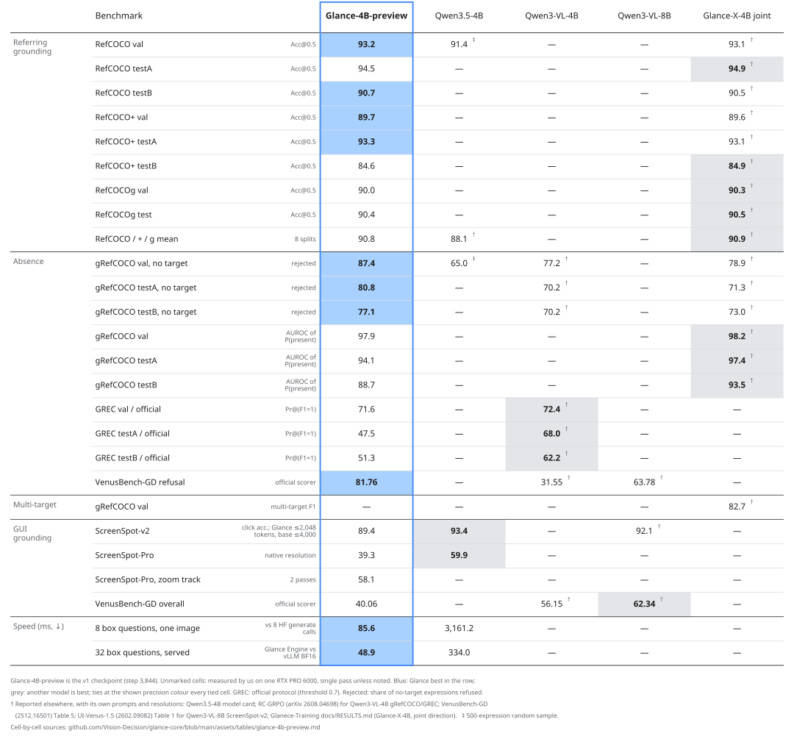
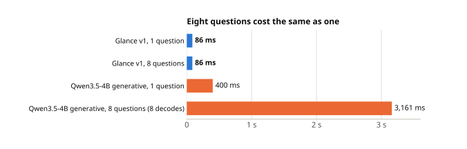

# glance-core

**Glance is a 4B vision-language model that answers typed questions about an image with calibrated probabilities,
from one forward pass, instead of generating text.** "Is it there?" comes back as P(present), "where?" as a box with
P(IoU ≥ 0.5), plus yes/no, multiple choice and scores. This repository holds the model code, training, data builders
and the evaluation harness behind it.

<picture>
  <source media="(prefers-color-scheme: dark)" srcset="assets/core-architecture-dark.svg">
  
</picture>

<sub>One prefill per image; every question is a short block that continues from it, and a head reads the answer from
the block's last hidden state. Layer counts from the Qwen3.5-4B config; heads in [`dv/model/`](dv/model) and
[`dv/config.py`](dv/config.py).</sub>

<table>
<tr>
<td align="center" width="33%"><h2>86 ms</h2>for 8 questions about one image, the same as for 1<br><sub>base Qwen3.5-4B, 8 separate text decodes, no prefix cache: 3,161 ms; against vLLM and SGLang see <a href="https://github.com/Vision-Decision/glance-engine">glance-engine</a></sub></td>
<td align="center" width="33%"><h2>87.4%</h2>of absent objects correctly rejected on gRefCOCO no-target<br><sub>base model 65.0% (500-item sample); same-data text model 88.4%</sub></td>
<td align="center" width="33%"><h2>16% vs 43%</h2>false refusals on real GUI targets, heads vs the same model answering in text<br><sub>ScreenSpot-v2, Glance v1 vs Gen-v1</sub></td>
</tr>
</table>

## Use the released model

The released weights are [`Vision-Decision/Glance-4B-preview`](https://huggingface.co/Vision-Decision/Glance-4B-preview);
the lightweight inference package is [Vision-Decision/Glance](https://github.com/Vision-Decision/Glance) and the
fast server is [glance-engine](https://github.com/Vision-Decision/glance-engine).

```bash
pip install "glance @ git+https://github.com/Vision-Decision/Glance"
curl -sLO https://raw.githubusercontent.com/Vision-Decision/Glance/main/assets/examples/park_bench.jpg
```

```python
from glance import Glance

m = Glance.from_pretrained("Vision-Decision/Glance-4B-preview")   # picks cuda, then mps, then cpu
r = m.box("park_bench.jpg", "the clear umbrella")
print(r.present_prob, r.box, r.confidence)
```

Come here to train, evaluate or change the model.

## Install

```bash
git clone https://github.com/Vision-Decision/glance-core.git && cd glance-core
pip install -e .            # torch, transformers 5.23.0, peft; add [gpu] on CUDA for the fused GDN kernels
```

On a CPU-only Linux machine, install the CPU torch wheel first
(`pip install torch torchvision --index-url https://download.pytorch.org/whl/cpu`). The distribution is
`glance-core`; the import name is `dv`. Other repositories depend on a pinned tag:

```toml
dependencies = ["glance-core @ git+https://github.com/Vision-Decision/glance-core@v0.2.0"]
```

## Quickstart: check the model code on CPU

```bash
python scripts/test_equivalence.py   # tiny random Qwen3.5: shared-prefix forward equals the HF reference -> EQUIVALENCE_OK
python scripts/test_multibox.py      # multi-instance box readout unit tests -> ALL PASS
```

Both download only the `Qwen/Qwen3.5-4B-Base` config and processor (a few MB, no weights) and take a few minutes on
CPU.

## Results

<picture>
  <source media="(prefers-color-scheme: dark)" srcset="assets/tables/glance-4b-preview-table-dark.svg">
  
</picture>

<sub><b>Glance-4B-preview against the models it is most often compared with.</b> It leads on rejecting absent
objects and on speed; Glance-X-4B leads on most RefCOCO splits and presence AUROC, Qwen3-VL-4B on the official GREC
metric, and the base model and Qwen3-VL on GUI grounding. Blue: Glance best in the row; grey: another model best;
† reported by others. Every cell's source: [`assets/tables/glance-4b-preview.md`](assets/tables/glance-4b-preview.md);
regenerate with `python assets/tables/bench_table.py assets/tables/glance-4b-preview.json OUT`.</sub>

<picture>
  <source media="(prefers-color-scheme: dark)" srcset="assets/core-results-dark.svg">
  
</picture>

<sub><b>Far better than the base model at saying “not here”, and as accurate as text answers on the same data.</b>
Gen-v1 trains the same backbone on the same data to answer in text: it matches Glance on boxes and rejects absent
objects one point more often (88.4 vs 87.4), so the data explains the accuracy. The heads buy the interface: one pass
for all questions, a better-ranked box confidence (AUROC 90.2 vs 88.3) and far fewer false refusals on GUI targets.
On screenshots, scaling the LoRA update to α = 0.5 and zooming inside the question block lift ScreenSpot-Pro from
50.1 to 68.75 without training (on an internal v1.1 checkpoint, not released yet; zoom track with extra passes, settings chosen on the test set, so not
comparable to single-pass leaderboards). A general 4B VLM (Qwen3-VL-4B, reported) still leads on VenusBench-GD through its clicks, and on raw clicks without the refusal gate Gen-v1 is also ahead (50.97 vs 47.28). Every value and its file: [`assets/core_results.py`](assets/core_results.py).</sub>

<picture>
  <source media="(prefers-color-scheme: dark)" srcset="assets/core-one-prefill-dark.svg">
  
</picture>

<sub><b>Eight questions cost the same as one.</b> Research forward (`eval.py --latency`) against the base model
generating text with Hugging Face `generate`, one decode per question as a plain client would (`baseline.py`), no
serving engine on either side; for serving-engine comparisons see
[glance-engine](https://github.com/Vision-Decision/glance-engine).</sub>


Glance v1 (the released weights) unless marked; official protocols where one exists.

| Benchmark | Result | Source |
|---|---|---|
| RefCOCO / + / g, 8 splits, mean Acc@0.5 | **90.8** | [`outputs/v1/eval_results.json`](outputs/v1/eval_results.json) (`sets.refcoco*.acc50`) |
| gRefCOCO val: no-target accuracy / presence AUROC / presence ECE | **87.4 / 97.9 / 2.3** | same, `sets.grefcoco_val_merged` |
| VenusBench-GD, official UI-Venus scorer: v1 / v1.1 | 40.06 / 40.68 | [`outputs/sprint_abs/v1/tables.md`](outputs/sprint_abs/v1/tables.md), [`v1.1`](outputs/sprint_abs/v1.1/tables.md) (`raw_gated`) |
| ScreenSpot-Pro, internal v1.1 checkpoint, official single-pass protocol, native resolution: Glance / base generative | 50.7 / 59.9 | [`outputs/sprint_gui/summary.md`](outputs/sprint_gui/summary.md), [`outputs/sspro_base/summary.md`](outputs/sspro_base/summary.md) |
| ScreenSpot-v2, v1.1 (better of two resolutions, chosen on test) / base generative | 90.1 / 93.4 | [`outputs/sprint_gui/summary.md`](outputs/sprint_gui/summary.md) |
| ScreenSpot-Pro, internal v1.1 checkpoint (not released), zoom track (extra passes; LoRA scale and crop settings chosen on the test set). The released Glance-4B-preview on the zoom track alone: 58.1 | 68.75 [66.4, 71.0] | [`outputs/arch/zoom/summary.md`](outputs/arch/zoom/summary.md) (the arch harness scores the first pass 50.1; bf16 batching) |
| Shifted descriptions (Chinese, paraphrase, functional, vague): accuracy, v1 → augmented data + consistency loss (a recipe, not released weights); base generative 80.2 | 75.0 → **83.6** | [`outputs/sprint_robust/summary/tables.md`](outputs/sprint_robust/summary/tables.md) |

**Same data, text answers.** Gen-v1 trains the same backbone on the same data to answer in text
([`outputs/gen_v1/summary.md`](outputs/gen_v1/summary.md)). It ties Glance on box accuracy and slightly beats it on
no-target accuracy (88.4 vs 87.4). Glance's advantage is the interface: a better box-confidence ranking (AUROC 90.2
vs 88.3, Δ +1.9 [+0.6, +3.2]) and far fewer false refusals on GUI targets (ScreenSpot-v2 16% vs 43%; VenusBench-GD
official 40.1 vs 28.2). On GUI click accuracy the base Qwen3.5-4B in generative mode is still ahead (ScreenSpot-v2
93.4).

## What is where

| Path | Contents |
|---|---|
| `dv/` | The model: shared-prefix backbone, box / IoU / typed / multi-box heads, data pipelines, the Glance-X shared core (`dv/glancex`) |
| `train.py`, `eval.py`, `baseline.py`, `configs/` | Training, evaluation and zero-shot baseline entry points; one JSON config per model version |
| `scripts/` | Data builders (v1 mixes, ground_v2, robust, multi-box, v1.2), VM setup and sync, CPU tests |
| `ablation/` | Controlled study: heads trained identically except for the output format |
| `gen_v1/` | The same-data generative baseline |
| `evals/`, `di/` | GUI benchmarks, the paired comparison with the Jev 1.14 API model, Decision Index runs |
| `arch/` | Architecture experiments: GDN, zoom, shortcut, multi-box variants |
| `outputs/` | Result files cited above; row dumps over 5 MB are on the Hub (see below) |
| `research/ambiguity_code/` | Probes for multi-instance ambiguity and attribute mismatch |
| `EXPERIMENTS.md` | Index of every experiment: command, data, checkpoint, result file (Chinese) |
| `docs/` | Design notes and the original project plan |

## Reproducing

Training and evaluation run on Colab G4 VMs (RTX PRO 6000 Blackwell, 96 GB). Data and checkpoints are on the Hub.
The released weights are public; the training data, intermediate checkpoints and row-level outputs below are private
to the Vision-Decision organisation for now, so the training commands need organisation access (`hf auth login`).

```bash
python scripts/fetch_large_files.py      # restores the >5 MB files listed in LARGE_FILES.tsv, sha256-checked
bash scripts/colab_setup.sh              # on a fresh VM: pinned deps, Qwen/Qwen3.5-4B, COCO train2014
python train.py --cfg configs/v1_4b.json
python eval.py --ckpt /content/out/v1/ckpt_final.pt --latency --out eval_results.json
```

| Artifact | Hugging Face location |
|---|---|
| Released weights (v1) | [`Vision-Decision/Glance-4B-preview`](https://huggingface.co/Vision-Decision/Glance-4B-preview) (public) |
| Checkpoints v1.2, multi-box, Gen-v1, scan, Glance-Video | `Vision-Decision/glance-train-ckpts` |
| Checkpoints v0, 27B, v1, v1.1, ablations, robustness recipes | `Vision-Decision/glance-train-ckpts-legacy` |
| Training pools, multi-box and v1.2 data, large repository files | `Vision-Decision/glance-train-data` (`git_large_files/` mirrors this repository's paths) |
| Grounding data from Glance-Data, v1.2 category-free set | `Vision-Decision/glance-ground-v2` |
| Shifted-description evaluation set | `Vision-Decision/glance-robust-ref` |
| Synthetic GUI data | `Vision-Decision/guisyn-v0` |

Per-experiment recipes (v0 → v1.2, ablations, official GREC / VenusBench-GD / ScreenSpot protocols, Jev and Decision
Index comparisons) are in [EXPERIMENTS.md](EXPERIMENTS.md); model and data design notes are in
[docs/DESIGN.md](docs/DESIGN.md).

## Status

- v1 is released as Glance-4B-preview. v1.2 and the multi-box variant are in evaluation on other branches.
- Research code: interfaces change between versions, and only `scripts/test_*.py` run without a GPU.

## Related repositories

| Repository | Contents |
|---|---|
| [glance-engine](https://github.com/Vision-Decision/glance-engine) | Inference engine and server; scanning one question over many cached images |
| [glance-video](https://github.com/Vision-Decision/glance-video) | Glance-Video and the video search tool for agents |
| [Glance](https://github.com/Vision-Decision/Glance) | Public model release and inference package |

## License

Code: Apache-2.0 ([LICENSE](LICENSE)). The released weights follow the license in their model card
(Glance-4B-preview: CC BY-NC 4.0).
